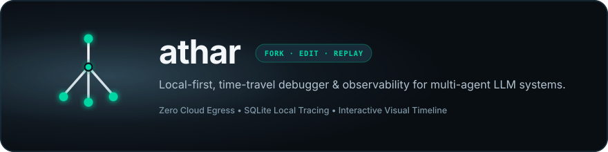
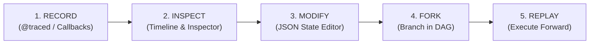
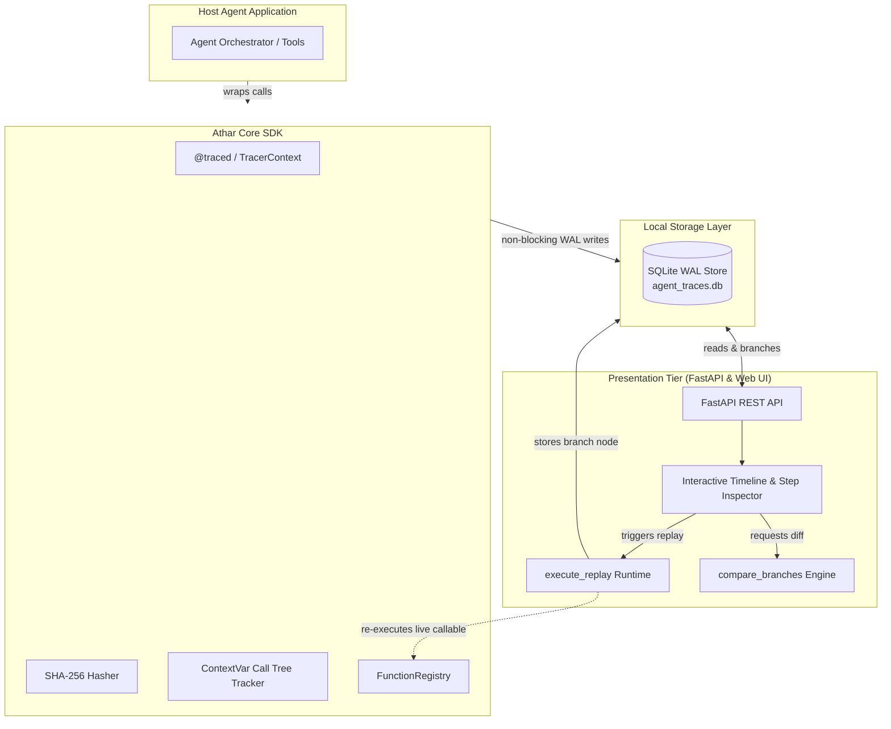

<div align="center">

  

  <br /><br />

  <h1>Athar (أثر)</h1>

  <p><b>A local-first, time-travel debugger for multi-agent LLM systems.</b></p>
  <p>Record an agent execution. Inspect what happened. Change a state. Replay from that point.</p>

  [](https://pypi.org/project/athar/)
  [](https://www.python.org/)
  [](tests/)
  [](#architecture)
  [](LICENSE)
  [](CONTRIBUTING.md)

  <br />

  <pre><code>pip install athar</code></pre>

  <p align="center">
    <a href="#10-second-summary">Summary</a> &bull;
    <a href="#the-problem-cascading-multi-agent-failures">The Problem</a> &bull;
    <a href="#how-athar-works">How It Works</a> &bull;
    <a href="#quick-start">Quick Start</a> &bull;
    <a href="#real-world-example-debugging-a-multi-agent-loop">Real-World Example</a> &bull;
    <a href="#architecture">Architecture</a> &bull;
    <a href="#supported-integrations">Integrations</a> &bull;
    <a href="#comparison-with-existing-tools">Comparison</a> &bull;
    <a href="#contributing-and-good-first-issues">Contributing</a>
  </p>

</div>

---

## 10-Second Summary

Debugging multi-agent systems is difficult because **errors compound**. When an agent loop fails on step 12 of 30, re-running from scratch burns API tokens, wastes minutes waiting for prior steps to complete, and often fails to reproduce the issue due to LLM stochasticity.

**Athar** solves this with local-first **time-travel debugging**:

- **Record**: Captures prompts, tool calls, return values, state snapshots, latency, and SHA-256 step hashes to a local SQLite database using Write-Ahead Logging (WAL).
- **Inspect**: Scrub through the execution timeline in a zero-dependency dark-mode web UI.
- **Modify**: Edit prompts, mock tool outputs, or tweak agent state at any step.
- **Fork & Replay**: Resume execution from that exact step forward. **Prior steps are never re-executed**, saving 100% of their API tokens and execution time.
- **Diff**: Compare branches side-by-side with delta cost, delta latency, and unified output diffs.

> **Zero cloud egress.** No accounts, no telemetry, no external database servers. Your prompts and proprietary agent code never leave your machine.

---

## The Problem: Cascading Multi-Agent Failures

Consider a real-world multi-agent workflow: an orchestrator agent delegates tasks to a web search tool, a code interpreter, and a report synthesizer across 30 sequential steps.

```
Step 1 (Plan) ──> Step 2 (Search) ──> ... ──> Step 12 (Tool Call) ──> Step 13 (Corrupted) ──> Step 30 (Failure)
```

At **Step 12**, the search tool returns a malformed schema or an ambiguous fact. Steps 13 through 30 proceed to hallucinate and compound the error.

```mermaid
flowchart TD
    subgraph Traditional["Traditional Debugging: Re-running From Scratch"]
        A1["Step 1: Planning"] --> A2["Step 2: Search Tool"]
        A2 --> A3["Step 12: Tool Malfunction"]
        A3 --> A4["Steps 13-30: Compounded Hallucinations"]
        A4 -.->|"Add print statements & rerun"| R1["Step 1: Re-executed (High Cost)"]
        R1 --> R2["Step 2: Re-executed (High Cost)"]
        R2 --> R3["Step 12: Stochastic LLM behaves differently"]
    end

    subgraph Athar["Athar: Time-Travel Fork & Replay"]
        B1["Step 1: Planning"] --> B2["Step 2: Search Tool"]
        B2 --> B3["Step 12: Tool Malfunction"]
        B3 --> B4["Steps 13-30: Preserved in History"]
        B3 ==>|"1. Mutate Input / State"| F1["Step 12 (Forked): Corrected Query"]
        F1 ==>|"2. Replay Forward Only"| F2["Step 13 (Replay): Clean Context"]
    end
```



### The Traditional Debugging Experience
1. **Wasted Cost & Latency**: To test a fix at Step 12, you must re-run Steps 1 through 11 every single time. A 30-step pipeline can easily burn \$2.00–\$5.00 and 90 seconds per iteration.
2. **LLM Stochasticity**: Even at `temperature=0`, non-deterministic provider routing and concurrent tool outputs mean re-running from scratch often fails to reproduce the exact state that caused the bug.
3. **SaaS Observability Gaps**: Tools like LangSmith, Langfuse, and Arize Phoenix are built for **post-mortem logging**, but they do not provide **interactive local time-travel replay**. You cannot click a node, edit its state, and live-execute forward inside your active Python environment.

---

## How Athar Works

Athar establishes a 5-stage lifecycle for agent execution:



1. **RECORD**: Wrap Python functions with `@traced` or pass `AtharCallbackHandler` to LangChain or LangGraph. Execution steps, inputs, outputs, errors, latency, and SHA-256 content hashes are written to local SQLite via thread-safe WAL mode.
2. **INSPECT**: Start `athar` and open `http://localhost:4173`. Scrub through the chronological execution cards or examine the parent-child DAG hierarchy.
3. **MODIFY**: Click the problematic step. In the Step Inspector, edit the input arguments, tool payload, or state snapshot in the JSON editor.
4. **FORK**: Athar creates a new execution branch (for example, `branch_empirical`) linked to the fork point. Historical traces remain immutable and intact.
5. **REPLAY**:
   - **Live Execution Mode**: If the function is registered in the active Python session, Athar re-invokes the real callable with mutated arguments, measuring true output and latency.
   - **State Mutation Mode**: If inspecting offline or across process restarts, Athar records a state mutation snapshot branch for downstream inspection.
   - **Semantic Branch Diff**: Compare the original and forked branches side-by-side with delta cost, delta latency, and unified text and JSON diffs.

---

## Quick Start

### Requirements
- **Python**: `>=3.9` (tested on 3.9, 3.10, 3.11, and 3.12).
- **Operating System**: macOS, Linux, or Windows.

### 1. Installation

Install via PyPI:
```bash
pip install athar
```

Or install from source for development:
```bash
git clone https://github.com/Abdur-Rafay-AR/athar.git
cd athar
pip install -e ".[dev]"
```

### 2. Minimal Working Example

Wrap your agent or tool functions with `@traced`. The decorator works seamlessly on both **async** and **sync** functions:

```python
import asyncio
from athar import traced, TracerContext

@traced
async def search_tool(query: str):
    # Simulates an external API or retrieval step
    await asyncio.sleep(0.1)
    return {"results": f"Latest data for: {query}"}

@traced
async def research_agent(topic: str):
    data = await search_tool(topic)
    res = data["results"]
    return f"Synthesized report based on {res}"

async def main():
    # Bundle execution inside a named trace session
    async with TracerContext(name="Market Intelligence Run"):
        report = await research_agent("Autonomous Coding Agents")
        print("Done:", report)

if __name__ == "__main__":
    asyncio.run(main())
```

Run the script:
```bash
python my_agent.py
```

### 3. Open the Athar Debugger UI

Start the local server:
```bash
athar
```
*(Or specify custom options: `athar --port 4173 --host 127.0.0.1 --db ./my_traces.db`).*

Visit **[http://localhost:4173](http://localhost:4173)** in your browser.

> **Tip**: If you haven't run any code yet, click the **"Seed Sample Trace"** button in the top navigation bar to populate a realistic multi-agent research workflow.

---

## Real-World Example: Debugging a Multi-Agent Loop

Here is how you debug an autonomous research workflow when an intermediate tool returns bad data:

```python
from athar import traced, TracerContext

@traced(cost=0.0005)
def market_search(query: str):
    # Suppose this initially returns an unhelpful generic response
    return {"status": "ok", "summary": "Generic market overview without metrics"}

@traced(cost=0.0020)
def synthesis_agent(context: dict):
    # Operates on the search output
    if "metrics" not in context.get("summary", ""):
        return "Warning: Insufficient data to synthesize definitive report."
    return "Final report: Enterprise velocity increased by 38%."

def run_pipeline():
    with TracerContext(name="Quarterly Velocity Analysis"):
        search_output = market_search("Developer productivity benchmarks")
        report = synthesis_agent(search_output)
        print("Pipeline Result:", report)

if __name__ == "__main__":
    run_pipeline()
```

### What Happens in Athar:
1. Run the script. The synthesizer warns of insufficient data.
2. Launch `athar` and open `http://localhost:4173`.
3. Select `market_search` in the timeline.
4. In the Step Inspector, change the output or arguments to:
   ```json
   {
     "summary": "Empirical study: metrics demonstrate 38% velocity increase across 45 teams"
   }
   ```
5. Click **"Execute Fork & Replay"**.
6. Athar creates `branch_replay_1` and re-runs `market_search (forked)` with the corrected input.
7. Click **"Compare Branches"** to verify that the synthesis output now succeeds, while reviewing the exact cost and latency delta.

| Dimension | Without Athar | With Athar |
| :--- | :--- | :--- |
| **Token Cost** | Re-spends tokens for all steps 1..N | **0 tokens** spent on prior steps |
| **Iteration Latency** | Full pipeline duration (30s–2min) | **Sub-second** replay from fork point |
| **Reproducibility** | Stochastic (LLM may drift) | **Deterministic** state injection |
| **Execution History** | Overwrites console logs | **Immutable DAG branches** in SQLite |

---

## Architecture

Athar is engineered as an offline-first system structured into three tiers:



### Subsystem Details

- **Instrumentation Engine (`athar.core.tracer`)**:
  - Transparently intercepts sync and async functions without modifying signatures or return types.
  - Automatically registers callables in `FunctionRegistry` for live re-execution.
  - Uses Python `contextvars` (`_active_trace_id`, `_active_parent_node_id`) to track parent-child call trees across nested agent calls and async task boundaries without manual span propagation.
- **Deterministic Step Fingerprinting**:
  - Computes a canonical SHA-256 hash over normalized inputs and outputs:
    $$\text{step\_hash} = \text{SHA256}(\text{canonical\_json}(\text{inputs}) \parallel \text{canonical\_json}(\text{outputs}))$$
  - Enables deduplication, cache validation, and divergence detection.
- **High-Concurrency SQLite Storage (`athar.storage.sqlite_store`)**:
  - `PRAGMA journal_mode=WAL;`: Permits concurrent reader threads (Web UI polling) and writer processes (high-throughput agent loops) without lock contention.
  - `PRAGMA synchronous=NORMAL;`: Maximizes write throughput while preserving ACID crash safety.
  - Thread-local connection pooling prevents SQLite connection sharing across threads.
- **Dynamic Replay Engine (`athar.core.replayer`, `athar.core.registry`)**:
  - Distinguishes between **Live Callable Replay** (active in-memory Python function re-invoked with mutated inputs) and **State Snapshot Forking** (offline inspection and annotation).
- **Semantic Branch Diffing (`athar.core.diff`)**:
  - Traverses the execution graph to detect fork points.
  - Computes exact cost differentials ($\Delta\text{cost} = \text{cost}_B - \text{cost}_A$) and latency differentials ($\Delta\text{latency} = \text{latency}_B - \text{latency}_A$).
  - Produces unified diffs of input and output payloads using standard `difflib`.

---

## Supported Integrations

### 1. Raw Python & Async Functions
Works with any custom agent loop, LangChain component, AutoGen step, or CrewAI task:

```python
from athar import traced, TracerContext

@traced(name="Summarizer", cost=0.001)
def summarize(text: str):
    return f"Summary of {len(text)} chars"

with TracerContext(name="Custom Loop"):
    summarize("Hello world")
```

### 2. LangChain & LangGraph Universal Callback Handler
Athar provides a first-class `AtharCallbackHandler` (inheriting from `BaseCallbackHandler`):

```python
from athar import AtharCallbackHandler

handler = AtharCallbackHandler(trace_name="LangChain Agent Run")

# Pass to any chain, graph, or agent run:
chain.invoke({"input": "Analyze market trends"}, config={"callbacks": [handler]})
```

The callback handler automatically captures:
- Chain invocations (`on_chain_start`, `on_chain_end`, `on_chain_error`)
- Tool calls and outputs (`on_tool_start`, `on_tool_end`, `on_tool_error`)
- LLM prompts, token usages, and costs (`on_llm_start`, `on_llm_end`)
- Hierarchical parent-child relationship tracking via LangChain `parent_run_id`

### 3. Crucible Multi-Agent Engine
Athar includes dedicated support for the [Crucible](https://github.com/Abdur-Rafay-AR/crucible) multi-agent framework:

```python
from athar import CrucibleAdapter

agent = CrucibleAdapter.wrap_agent(my_crucible_agent)
agent.run()
```

---

## Design Decisions

| Decision | Why Athar Does It | Trade-Off |
| :--- | :--- | :--- |
| **Local-First (SQLite WAL)** | Zero privacy risk, zero cloud egress, zero SaaS costs, zero external database setup (Docker/Postgres). | Traces reside on your local machine; team sharing requires exporting or copying the `.db` file. |
| **Deterministic SHA-256 Hashes** | Verifies whether a replayed step actually altered inputs or outputs compared to the original execution. | Minor serialization overhead per step (~0.05ms for typical JSON payloads). |
| **Immutability of History** | Replaying never overwrites historical execution nodes; it creates new branches (`branch_id`) referencing the parent. | Database file grows with each branch until vacuumed or cleared. |
| **Dual Replay Modes** | Allows live Python execution when running interactive sessions, while gracefully supporting offline trace inspection. | Re-executing live code across process restarts requires the host script to re-register its functions. |

---

## Comparison With Existing Tools

| Capability | Athar | LangSmith | Langfuse | Arize Phoenix | LangGraph Studio |
| :--- | :---: | :---: | :---: | :---: | :---: |
| **Primary Focus** | **Time-travel debugging & state replay** | Production tracing & evaluation | Observability & prompt management | LLM tracing & evaluations | Graph execution visualizer |
| **Deployment Model** | **100% Local-first (single `.db`)** | SaaS (Cloud) / Enterprise | Self-hosted (Docker) or Cloud | Self-hosted or Cloud | Desktop App / Cloud |
| **Data Privacy** | **Zero cloud egress** | Sends data to cloud | Depends on deployment | Depends on deployment | Local / Cloud |
| **State Mutation & Replay** | **Native UI + Live Python re-execution** | Manual playground rerun | Manual rerun | Trace viewing only | Step checkpoint rewinding |
| **Prior Step Skipping** | **Prior steps are never re-executed** | No | No | No | Checkpoint dependent |
| **Semantic Branch Diff** | **Built-in ($\Delta\text{cost}$, $\Delta\text{latency}$, diffs)** | Basic comparison | No | No | No |
| **Infrastructure Overhead** | **`pip install athar` (0 config)** | API key & network | PostgreSQL + ClickHouse | Docker container | Docker / LangGraph CLI |

---

## Current Limitations

To maintain technical credibility, we document our current constraints honestly:

1. **Single-Node Replay vs. Cascading Pipeline Execution**:
   Athar currently re-executes the selected step and logs the resulting branch node. In custom Python agent loops, automatic multi-step cascading replay requires orchestrator re-invocation. Full multi-step graph cascade replay is actively being implemented for v0.4.
2. **In-Memory Registry Scope**:
   Live Python callable re-execution requires the host process to have registered the function via `@traced` or `get_registry().register()`. If you restart your machine and inspect historical traces using standalone `athar`, Athar operates in **State Mutation Mode** (recording mutated state snapshots rather than executing arbitrary Python code in the server process).
3. **LLM Stochasticity**:
   Re-running an LLM step without setting `temperature=0` or enabling response caching will produce a stochastic completion. Athar records both the original and new outputs so you can compare differences directly.
4. **Side-Effecting Tools**:
   If an agent step performs destructive real-world side effects (for example, executing a financial transaction or sending an email), replaying that step will trigger the side effect again unless the tool is guarded or mocked.

---

## Roadmap

- [x] **v0.1**: Local-first tracer SDK (`@traced`, `TracerContext`), SQLite WAL store, FastAPI server, interactive timeline UI, dynamic replay runtime.
- [x] **v0.2**: Side-by-side semantic branch diff visualizer (compare outputs, cost differentials, and latency between forks).
- [x] **v0.3**: Universal LangChain & LangGraph callback adapter (`AtharCallbackHandler`), Crucible adapter, CLI entrypoint (`athar`).
- [ ] **v0.4**: Live trace streaming via WebSockets / Server-Sent Events (SSE).
- [ ] **v0.5**: Automated multi-step cascade replay engine for directed acyclic agent graphs.
- [ ] **v1.0**: Trace export utilities (OpenTelemetry & JSON-L format) and multi-session sharing.

---

## Contributing and Good First Issues

We welcome contributions from the community. Whether you want to add adapters for new frameworks, improve the web UI, or optimize SQLite storage, your help is appreciated.

### Quick Setup

```bash
# 1. Clone the repository
git clone https://github.com/Abdur-Rafay-AR/athar.git
cd athar

# 2. Create virtual environment
python -m venv venv
source venv/bin/activate  # On Windows: venv\Scripts\activate

# 3. Install in editable mode with dev dependencies
pip install -e ".[dev]"

# 4. Run the test suite
python -m unittest discover -s tests -p "test_*.py"
```

### Curated Good First Issues

Looking for a place to start? Here are four high-impact, well-scoped tasks ready for contributors:

1. **Issue #1: Add CLI Trace Export (`athar export`)**
   - *Goal*: Add a CLI flag to export recorded traces from SQLite to formatted JSON or OpenTelemetry trace format.
   - *Relevant files*: `src/athar/ui/app.py`, `src/athar/storage/sqlite_store.py`.
2. **Issue #2: Native AutoGen Adapter**
   - *Goal*: Create `athar.adapters.autogen` to automatically wrap AutoGen's `ConversableAgent` message exchange loops.
   - *Relevant files*: `src/athar/adapters/`.
3. **Issue #3: Timeline Text Search & Tag Filter in Web UI**
   - *Goal*: Add a search bar to the center timeline in `index.html` to filter cards by function name, branch name, or execution error.
   - *Relevant files*: `src/athar/ui/static/index.html`.
4. **Issue #4: Side-Effect Dry-Run Guard for Replay**
   - *Goal*: Add a `@traced(is_idempotent=False)` parameter to warn users in the UI before replaying functions that perform destructive side effects.
   - *Relevant files*: `src/athar/core/tracer.py`, `src/athar/core/replayer.py`.

See [CONTRIBUTING.md](CONTRIBUTING.md) for full style guidelines, branch naming conventions, and testing practices.

---

## Meaning of "Athar"

**Athar** (أثر) is an Arabic word meaning **trace**, **imprint**, or **footprint**. In multi-agent AI systems, understanding the exact trace left behind by an agent's reasoning process is the key to deterministic reliability and time-travel interpretability.

---

## License and Community

Distributed under the [MIT License](LICENSE). Copyright © 2026 Abdur Rafay.

- **Found a bug?** Open an issue on [GitHub Issues](https://github.com/Abdur-Rafay-AR/athar/issues).
- **Have an idea?** Start a discussion or submit a Pull Request.
- **Enjoying Athar?** Consider [starring the repository](https://github.com/Abdur-Rafay-AR/athar) to support local-first developer tooling!
