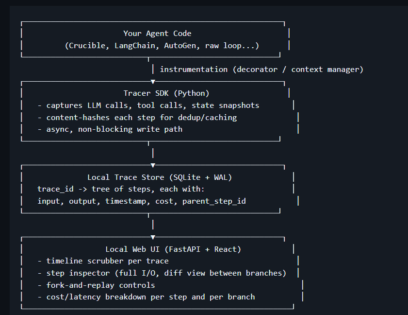

# Agent Tracer 🕵️‍♂️🔍


**A local-first, time-travel debugger for multi-agent LLM systems.**

Agent Tracer records every step a multi-agent system takes (prompts, tool calls, tool results, intermediate reasoning) into a local trace store, and gives you a UI to scrub through that history, fork execution from any point, edit the state at that point, and replay forward without re-running everything that came before it.

No account. No cloud. No vendor lock-in. SQLite on disk, a local web UI, done.

***

## 🚀 The Problem

If you've built anything beyond a single-agent toy, you've hit this: an agent does something wrong four steps into a run, and your only tools to figure out why are `print()` statements and re-running the whole thing from scratch, hoping it fails the same way twice (it often doesn't, because LLMs aren't deterministic).

Existing observability tools solve *logging* (you can see what happened). None of them solve *debugging* (going back to step 3, changing what the tool returned, and seeing what the agent does differently from there, without burning tokens re-running steps 1 and 2). They're also largely cloud/SaaS-first, which is a non-starter if you're running agents locally against Ollama or similar for cost, privacy, or latency reasons.

Agent Tracer is built around one core mechanic that doesn't really exist elsewhere in an accessible form: **fork and replay**.

## 🛠️ Core Mechanic: Fork and Replay

1. Every agent run is recorded as a trace: a tree of steps (LLM calls, tool calls, tool results, state mutations), each with full input/output and a content hash.
2. Open any trace in the UI and scrub through it like a video timeline.
3. Pick any step. Edit the prompt, the tool result, or the agent's state at that point.
4. Hit replay. Execution resumes from that step forward using your edited state. Steps before the fork point are never re-executed, so you're not re-paying for or re-waiting on work you already did.
5. The result is a new branch in the trace tree, so you can compare the original run against your "what if" run side by side.

This turns debugging a bad agent decision from "re-run the whole pipeline and hope" into "fix the one thing you think is wrong and see what happens next", similar to the mental model of `git rebase -i` or a real debugger's "set next statement."

## 🏗️ Architecture



Replay execution re-invokes your actual agent/tool code starting at the fork point. Agent Tracer doesn't simulate anything; it calls your real functions with the edited state, so behavior after the fork is exactly as real as the original run.

## ✨ Key Features (v0.1 Release)

- **Zero-config instrumentation**: one decorator (`@traced`) or context manager around your agent loop; no changes to agent logic required.
- **Framework-agnostic capture**: works with raw Python agent loops, LangChain, AutoGen, and Crucible out of the box via thin adapters.
- **Fork and replay**: the core mechanic described above.
- **Branch diffing**: side-by-side comparison of two branches from the same fork point (what changed in output, cost, latency, tool calls made).
- **Cost and latency breakdown**: per-step and per-branch, so you can see exactly which step in a 20-step trace is expensive or slow.
- **Local-first**: SQLite trace store, no external service, no API key required to use the core tool.

## 💻 Quickstart

### Installation

```bash
git clone https://github.com/yourusername/agent-tracer.git
cd agent-tracer
pip install -e .
```

### 1. Instrument your code
Simply add the `@traced` decorator to any agent or tool function:

```python
import asyncio
from agent_tracer import traced

@traced
async def my_llm_agent(prompt: str):
    print(f"Agent thinking about: {prompt}")
    # ... your actual LLM or tool calling logic here ...
    await asyncio.sleep(1) # Simulating work
    return {"status": "success", "response": f"Processed: {prompt}"}

async def main():
    await my_llm_agent("What is the capital of France?")

if __name__ == "__main__":
    asyncio.run(main())
```

### 2. View the UI
Start the local server to explore your traces and use time-travel debugging:

```bash
# On Windows
run-local.cmd

# Or manually
agent-tracer
```
Then open `http://localhost:4173/static/index.html` in your browser.

## 🗺️ Roadmap

- [x] **v0.1**: SDK with decorator-based capture + SQLite store, local web UI timeline view, fork/replay basics.
- [ ] **v0.2**: Enhanced branch diffing + cost/latency breakdown visualizers.
- [ ] **v0.3**: Deep Crucible adapter, LangChain adapter integrations.
- [ ] **v1.0**: Stable SDK API, documented extension points for custom adapters.

## 🤝 Why this exists

Built as the debugging layer I wanted while working on Crucible. Multi-agent systems are hard enough to reason about when everything works; they're nearly impossible to debug with print statements when something goes wrong three agents deep. This is the tool I kept wishing existed.

## 📄 License

MIT
