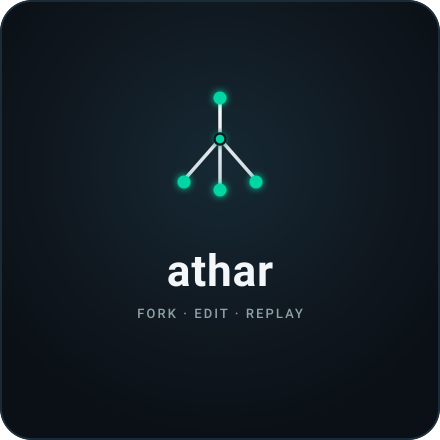
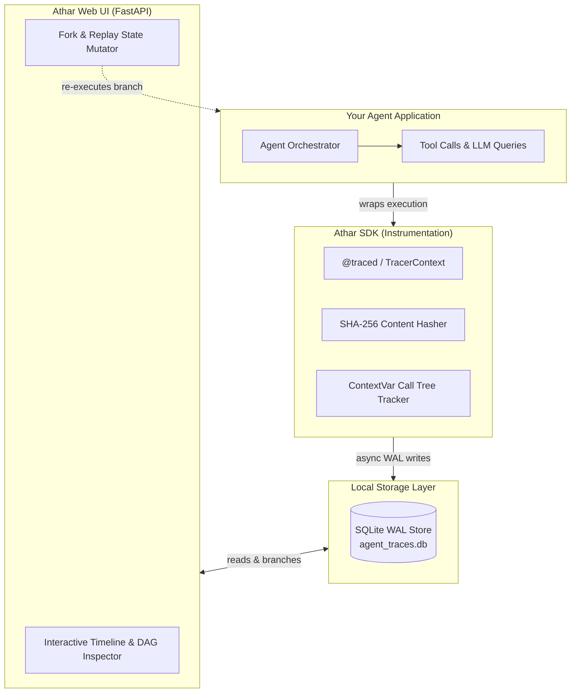

<div align="center">

  

  # athar (أثر)
  
  **A local-first, time-travel debugger and observability engine for multi-agent LLM systems.**

  [](https://pypi.org/project/athar/)
  [](tests/)
  [](https://www.python.org/)
  [](LICENSE)
  [](CONTRIBUTING.md)
  [](#architecture)

  <br />

  <p align="center">
    <code>fork</code> &nbsp;&bull;&nbsp; <code>edit</code> &nbsp;&bull;&nbsp; <code>replay</code>
  </p>

  <p align="center">
    <i>No account. No cloud fees. No vendor lock-in. Just SQLite on disk, a sleek local web UI, and instantaneous time-travel replays.</i>
  </p>

</div>

---

## 💡 Why Athar?

If you have built anything beyond a single-prompt toy, you've encountered this nightmare:

> *Your multi-agent loop fails on step 6 of 10. You add a `print()` statement, re-run the entire pipeline, burn hundreds of thousands of tokens, wait 45 seconds, and... it succeeds this time because LLMs are stochastic.*

Existing observability platforms (LangSmith, Phoenix, Langfuse) solve **logging**—you can see what went wrong after the fact. **None of them solve interactive debugging**:

- ❌ Re-running from scratch burns money and wastes time.
- ❌ SaaS observability platforms require sending private prompts, embeddings, and customer data to external cloud vendors.
- ❌ You cannot easily mutate the state at step 4 and test *“what if the tool returned X instead?”*.

### The Athar Solution: **Fork & Replay**

Athar records every execution step (prompts, tool calls, tool results, state snapshots) into a local SQLite database using Write-Ahead Logging (WAL). 

When an agent goes off track:
1. **Scrub** through the execution timeline in the local web UI.
2. **Select** the exact step where things went wrong.
3. **Mutate** the prompt, tool output, or agent state in the inspector.
4. **Hit Replay**: Athar resumes execution from that step forward. **Prior steps are never re-executed**, saving your API credits and minutes of wait time.
5. Athar creates a new branch in the trace graph, letting you compare the original vs. mutated paths side-by-side.

---

## ⚡ 10-Second Quickstart

### 1. Installation

Install via PyPI:
```bash
pip install athar
```

Or install from source for development:
```bash
git clone https://github.com/Abdur-Rafay-AR/athar.git
cd athar
pip install -e ".[dev]"
```

### 2. Instrument Your Code

Wrap any agent or tool function with `@traced`:

```python
import asyncio
from athar import traced, TracerContext

@traced
async def search_tool(query: str):
    # Simulating a search tool or API lookup
    await asyncio.sleep(0.2)
    return {"results": f"Found latest data for: {query}"}

@traced
async def research_agent(topic: str):
    print(f"Researching: {topic}")
    data = await search_tool(topic)
    return f"Synthesized report based on {data['results']}"

async def main():
    # Bundle execution inside a named trace session
    async with TracerContext(name="Market Intelligence Run"):
        report = await research_agent("Autonomous Coding Agents")
        print("Done:", report)

if __name__ == "__main__":
    asyncio.run(main())
```

### 3. Open the Athar Debugger UI

Start the local server:

```bash
athar
```
*(Or run `run-local.cmd` on Windows).*

Open **[http://localhost:4173](http://localhost:4173)** to scrub through steps, inspect inputs/outputs, and initiate time-travel replays!

---

## 🏛️ Architecture



### System Architecture Highlights

- **SQLite WAL Mode**: Thread-safe, non-blocking concurrent writes from high-throughput agent loops while the Web UI live-polls data.
- **Deterministic Content Hashing**: Every step generates a SHA-256 fingerprint based on inputs, state, and function signatures.
- **ContextVar Hierarchy Chaining**: Automatically preserves parent-child relationships across nested agent calls and async tasks without messy manual span propagation.

---

## ✨ Features

- 🌿 **Time-Travel Fork & Replay**: Edit inputs or state snapshots at any node and live-execute real Python code without re-running earlier nodes.
- 🔬 **Semantic Branch Diffing**: Compare two execution branches side-by-side with $\Delta\text{cost}$, $\Delta\text{latency}$, and unified JSON/text diffs.
- 🦜 **Universal LangChain & LangGraph Support**: Drop-in `AtharCallbackHandler` instruments any chain or graph in one line of code.
- 🔒 **100% Local & Private**: No cloud credentials, zero telemetry, no external database dependencies. Your sensitive prompts and proprietary agent code never leave your machine.
- ⚡ **Zero-Overhead Instrumentation**: Drop-in `@traced` decorator and `TracerContext` context manager with negligible runtime impact.
- 📊 **Step Inspector**: Real-time view of inputs, arguments, outputs, errors, latency, and cost per step.
- 🎨 **Modern Dark-Mode UI**: Built with a clean aesthetic, interactive timeline cards, live callable indicators, and branch comparison modal.

---

## 🦜 1-Line LangChain Integration

If you use LangChain, LangGraph, or CrewAI, instrument your application with zero code modifications:

```python
from athar import AtharCallbackHandler

handler = AtharCallbackHandler(trace_name="Market Analysis Chain")

# Pass to any LangChain invocation:
chain.invoke({"topic": "AI Trends"}, config={"callbacks": [handler]})
```

All chain steps, tool invocations, prompts, and token usages are automatically streamed into Athar.

---

## 🖥️ CLI Commands

```bash
# Launch Athar UI on default port 4173
athar

# Launch on custom port and host
athar --port 8080 --host 0.0.0.0

# Point to a custom SQLite database file
athar --db ./path/to/my_traces.db
```

---

## 🛠️ Development & Testing

We welcome contributions! Run the automated test suite with Python's built-in `unittest` or `pytest`:

```bash
# Install with dev dependencies
pip install -e ".[dev]"

# Run tests
python -m unittest discover -s tests
```

See [CONTRIBUTING.md](CONTRIBUTING.md) for details on development workflows, adapters, and style guidelines.

---

## 🗺️ Roadmap

- [x] **v0.1**: Local-first tracer SDK, SQLite WAL store, FastAPI server, interactive timeline UI, dynamic replay runtime.
- [x] **v0.2**: Side-by-side branch diff visualizer (compare outputs, cost differences, and token latency between two forks).
- [x] **v0.3**: Universal LangChain & LangGraph callback adapter (`AtharCallbackHandler`).
- [ ] **v0.4**: Live trace streaming via WebSockets / Server-Sent Events (SSE).
- [ ] **v1.0**: Stable SDK API, export traces to OpenTelemetry, and team sharing utilities.

---

## 📜 Meaning of "Athar"

**Athar** (أثر) is an Arabic word meaning **trace**, **imprint**, or **footprint**. In agentic AI systems, understanding the exact trace left behind by an agent's reasoning process is the key to mastering reliability, interpretability, and deterministic debugging.

---

## 📄 License

Distributed under the [MIT License](LICENSE). Copyright © 2026 Abdur Rafay.
